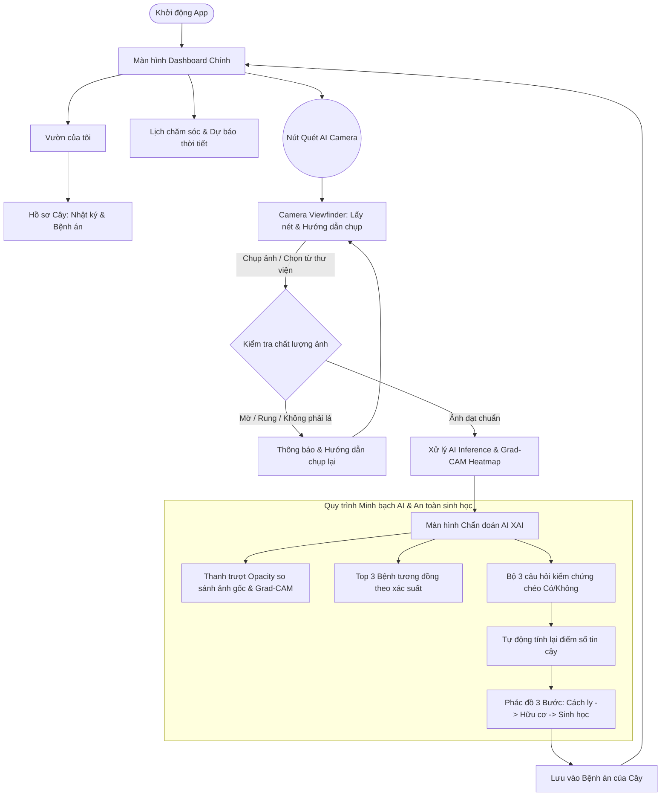

# TÀI LIỆU THIẾT KẾ UI/UX WIREFRAME & PROTOTYPE (US-003)

- **Mã User Story**: `US-003`
- **Tên tính năng**: Thiết kế Wireframe và Prototype cho ứng dụng di động Urban Plants
- **Người thực hiện**: `@architect`
- **Ngày hoàn thành**: 2026-10-18
- **Trạng thái**: HOÀN THÀNH (Bàn giao cho Senior Dev & Product Owner)
- **Quy chuẩn tuân thủ**: [AGENT.md](../../AGENT.md), [urban-plant-trust-protocol.md](../../.agents/rules/urban-plant-trust-protocol.md)

---

## 1. Mục tiêu và Định vị Trải nghiệm Người dùng (UX Goals)

Ứng dụng di động **Urban Plants** hướng tới nhóm đối tượng cư dân đô thị (trồng hoa hồng, sen đá, kiểng lá, rau gia vị ở ban công, sân thượng hoặc phòng khách). Người dùng đô thị thường thiếu kinh nghiệm chuyên sâu về nông nghiệp, dễ hoang mang khi cây bệnh và rất nhạy cảm với hóa chất độc hại trong không gian kín của gia đình.

Do đó, trải nghiệm UI/UX phải đạt 4 tiêu chí cốt lõi:
1. **Trực quan & Tươi sáng (Bio-Aesthetics)**: Tông màu xanh thiên nhiên dịu mắt, thẻ bo góc lớn (16px), micro-interactions mượt mà.
2. **Minh bạch AI (Explainable AI - XAI)**: Không phán đoán mập mờ; hiển thị vùng nhiệt Grad-CAM với thanh trượt trực quan để người dùng hiểu rõ căn cứ chẩn đoán.
3. **Độ tin cậy đa chiều (Differential Diagnosis)**: Gợi ý Top 2-3 bệnh tương đồng và đưa ra bộ 3 câu hỏi kiểm chứng xúc giác/mắt thường Có/Không trước khi kết luận.
4. **An toàn sinh học trước tiên (Safe-First Protocol)**: Luôn đưa phương án cách ly, cắt tỉa và xử lý hữu cơ lành tính lên hàng đầu, bảo vệ trẻ nhỏ và thú cưng trong nhà.

---

## 2. Design System Tokens (Hệ thống Quy chuẩn Thiết kế)

### 2.1. Color Palette (Bảng màu)

| Token Name | Mã Hex | Ý nghĩa sử dụng |
| :--- | :--- | :--- |
| `primary-green` | `#2D6A4F` | Màu chủ đạo thương hiệu (Thanh điều hướng, nút hành động chính CTA) |
| `secondary-green` | `#52B788` | Điểm nhấn tăng trưởng, trạng thái cây khỏe, icon phụ |
| `mint-surface` | `#E8F5E9` | Màu nền của các thẻ card, phác đồ điều trị sinh học |
| `alert-orange` | `#E76F51` | Cảnh báo bệnh trung bình, triệu chứng cần theo dõi |
| `critical-red` | `#D62828` | Cảnh báo bệnh nguy hiểm, sâu hại có nguy cơ lây lan nhanh |
| `warning-amber` | `#F4A261` | Cảnh báo thời tiết (sốc nhiệt, mưa dông) |
| `neutral-dark` | `#1B2D2A` | Màu chữ tiêu đề (H1, H2, H3) và văn bản chính |
| `neutral-muted` | `#6C757D` | Màu chữ phụ, chú thích (caption), timestamp |
| `background-app` | `#F8FAF9` | Màu nền toàn bộ ứng dụng (chống mỏi mắt) |
| `card-surface` | `#FFFFFF` | Nền trắng thẻ thông tin, card elevation nhẹ |

### 2.2. Typography (Kiểu chữ)

- Font chữ đề xuất: `Plus Jakarta Sans` hoặc `Inter` (Font sans-serif hiện đại, độ dễ đọc cao trên màn hình di động).
- `Display / H1`: 24px - Bold (700) - Dùng cho tiêu đề màn hình chính.
- `Heading / H2`: 18px - Semi-bold (600) - Tên loại bệnh, tên chậu cây, phân đoạn.
- `Heading / H3`: 15px - Medium (500) - Tiêu đề phụ, nhãn các bước phác đồ.
- `Body Text`: 14px - Regular (400) - Chi tiết hướng dẫn, mô tả triệu chứng.
- `Caption / Badge`: 11px - Semi-bold (600) - Tag mức độ, ngày giờ, số lượng.

### 2.3. Elevation & Radius

- **Border Radius**: Card `16px`, Button `12px`, Dialog / Bottom Sheet `24px`.
- **Shadow**: `0px 4px 16px rgba(45, 106, 79, 0.08)` (đổ bóng xanh tự nhiên, không dùng bóng đen sắc cạnh).

---

## 3. Kiến trúc Luồng Thông tin (User Flows)



---

## 4. Đặc tả Chi tiết Wireframe các Màn hình Chính

### 4.1. Screen 1: Dashboard Trang chủ (Home & Quick Action)

```text
+-----------------------------------------------------------+
| [Avatar] Xin chào, Hoàng Nam!           [Chuông Báo (2)]  |
| Vị trí: Q. Bình Thạnh, TP.HCM | 31°C - Mưa chiều 60%      |
+-----------------------------------------------------------+
| [WIDGET THỜI TIẾT THÔNG MINH]                             |
| 🌦️ Hôm nay trời có mưa lớn vào 16:00                     |
| => Khuyến nghị: Hoãn lịch tưới cây ngoài ban công hôm nay!|
| [Nút: Xem dự báo chi tiết]                                |
+-----------------------------------------------------------+
| VIỆC CẦN LÀM HÔM NAY (3)                                  |
| [ ] Tưới nước Cà chua bi (Ban công Đông)    [Đã làm] [Hoãn]|
| [ ] Xoay hướng nắng Sen đá (Bậu cửa sổ)     [Đã làm]      |
| [!] Kiểm tra đốm trắng Hoa hồng (Góc vườn)   [Quét AI ngay] |
+-----------------------------------------------------------+
| VƯỜN CỦA TÔI (6 chậu)                      [+ Thêm cây]   |
| +-----------------+  +-----------------+  +--------------+|
| | [Ảnh Hoa Hồng]  |  | [Ảnh Sen Đá]    |  | [Ảnh Cà Chua]||
| | Hồng Mon Coeur  |  | Sen Đá Phật Bà  |  | Cà Chua Bi   ||
| | [!] Cần kiểm tra|  | [OK] Khỏe mạnh   |  | [OK] Đơm hoa ||
| +-----------------+  +-----------------+  +--------------+|
+-----------------------------------------------------------+
|          [   📷 NÚT QUÉT BỆNH AI - TRUNG TÂM   ]          |
| [Trang chủ]    [Vườn của tôi]    [Lịch trình]    [Cá nhân]|
+-----------------------------------------------------------+
```

---

### 4.2. Screen 2: Khung ngắm Camera Chẩn đoán AI (AI Viewfinder)

```text
+-----------------------------------------------------------+
| [X Đóng]            [Flash: Tắt]             [Thư viện ảnh]|
+-----------------------------------------------------------+
|                                                           |
|             .-------------------------------.             |
|             |  [ + ] Hướng dẫn lấy nét:     |             |
|             |  Đặt lá cây có đốm bệnh vào   |             |
|             |  giữa khung tròn này          |             |
|             |                               |             |
|             |           (  O  )             |             |
|             |                               |             |
|             |  Khoảng cách tối ưu: 15-20cm  |             |
|             '-------------------------------'             |
|                                                           |
|    [!] Cảnh báo thời gian thực: Ánh sáng đủ - Giữ chắc tay|
|                                                           |
+-----------------------------------------------------------+
|                      [   ⚪ NÚT CHỤP   ]                   |
|                   [Chế độ: Lá đơn / Cụm lá]               |
+-----------------------------------------------------------+
```

---

### 4.3. Screen 3: Kết quả Chẩn đoán Explainable AI (Grad-CAM & Differential)

> **Tuân thủ [urban-plant-trust-protocol.md](../../.agents/rules/urban-plant-trust-protocol.md)**: Có thanh trượt so sánh Grad-CAM, Top 2-3 bệnh tương đồng, không khẳng định 100% tuyệt đối.

```text
+-----------------------------------------------------------+
| [< Quay lại]         KẾT QUẢ PHÂN TÍCH AI         [Chia sẻ]|
+-----------------------------------------------------------+
| [KHU VỰC ẢNH CHẨN ĐOÁN & BẢN ĐỒ NHIỆT GRAD-CAM]           |
| +-------------------------------------------------------+ |
| |        [ẢNH LÁ CÂY VỚI VÙNG NHIỆT GRAD-CAM ĐỎ/VÀNG]   | |
| |  "Vùng nhiệt tập trung ở mép lá: Đốm phấn nấm sợi"    | |
| +-------------------------------------------------------+ |
| Kéo thanh trượt để so sánh ảnh gốc và bản đồ nhiệt AI:   |
| [Ảnh gốc] -----------●----------------- [Bản đồ nhiệt]    |
| (Opacity: 65%)                                            |
+-----------------------------------------------------------+
| CHẨN ĐOÁN KHẢ DĨ NHẤT:                                    |
| 🔴 BỆNH PHẤN TRẮNG (Powdery Mildew - Podosphaera pannosa) |
| - Mức độ: Trung bình (Lây lan nhanh)                      |
| - Độ tin cậy hình ảnh ban đầu: 78.5%                      |
+-----------------------------------------------------------+
| CÁC BỆNH CÓ TRIỆU CHỨNG TƯƠNG ĐỒNG (Differential Top 3):  |
| 1. Bệnh Mốc xám (Botrytis cinerea)               - 14.2%  |
| 2. Dư lượng khoáng vôi nước tưới (Vô hại)        -  7.3%  |
+-----------------------------------------------------------+
| [👉 BẤM ĐỂ TRẢ LỜI 3 CÂU HỎI XÁC THỰC LẠI ĐỘ CHÍNH XÁC]    |
+-----------------------------------------------------------+
```

---

### 4.4. Screen 4: Bộ 3 Câu hỏi Kiểm chứng Chéo (Cross-Check Verification)

> **Tuân thủ [urban-plant-trust-protocol.md](../../.agents/rules/urban-plant-trust-protocol.md)**: Hỏi kiểm chứng xúc giác/mắt thường Có/Không để tái tính điểm số.

```text
+-----------------------------------------------------------+
| [<]             XÁC THỰC TRIỆU CHỨNG THỰC TẾ              |
+-----------------------------------------------------------+
| Hãy chạm nhẹ hoặc quan sát kỹ chiếc lá để AI đưa ra       |
| kết luận chính xác 100% cho cây của bạn:                  |
|                                                           |
| Câu hỏi 1: Lớp bụi trắng trên lá có lau sạch dễ dàng      |
| bằng ngón tay không?                                      |
| ( ) Có, lau là bay lớp bột mỏng                           |
| ( ) Không, dính chặt vào mô lá                            |
|                                                           |
| Câu hỏi 2: Mặt dưới của lá có thấy tơ nhện li ti hoặc con |
| bọ nhỏ bò chậm không?                                     |
| ( ) Có (Dấu hiệu của nhện đỏ / bọ trĩ)                    |
| ( ) Không (Chỉ có vết bột trắng)                          |
|                                                           |
| Câu hỏi 3: Lá non bị bệnh có hiện tượng xoăn tít lại      |
| và khô giòn ở chóp không?                                 |
| ( ) Có                                                    |
| ( ) Không                                                 |
|                                                           |
| [   TÍNH LẠI ĐỘ CHÍNH XÁC & XEM PHÁC ĐỒ ĐIỀU TRỊ   ]      |
+-----------------------------------------------------------+
| Kết quả sau kiểm chứng:                                   |
| Độ tin cậy tăng lên: 94.2% - Khẳng định: Nấm Phấn Trắng    |
+-----------------------------------------------------------+
```

---

### 4.5. Screen 5: Phác đồ Điều trị 3 Tầng An Toàn Sinh Học (Safe-First Protocol)

> **Tuân thủ bắt buộc [urban-plant-trust-protocol.md](../../.agents/rules/urban-plant-trust-protocol.md)**: 
> Bước 1: Cách ly & Cắt tỉa -> Bước 2: Giải pháp hữu cơ pha tại nhà -> Bước 3: Hoạt chất sinh học. Tuyệt đối không dùng tên thương phẩm độc hại.

```text
+-----------------------------------------------------------+
| [<]           PHÁC ĐỒ ĐIỀU TRỊ AN TOÀN SINH HỌC           |
+-----------------------------------------------------------+
| Phác đồ chuẩn hóa cho: Bệnh Phấn Trắng trên Hoa Hồng      |
| Môi trường khuyến nghị: Ban công / Trong nhà có trẻ nhỏ   |
+-----------------------------------------------------------+
| [BƯỚC 1: CÁCH LY & CẮT TỈA CƠ HỌC] (Bắt buộc làm ngay)   |
| - Tách chậu hoa hồng ra xa các cây khác tối thiểu 1.5m.   |
| - Dùng kéo đã khử trùng bằng cồn 70° cắt bỏ toàn bộ lá bị |
|   nhiễm nấm nặng (>50% bề mặt). Cho lá vào túi kín vứt rác|
| - Rửa tay và lau sạch kéo trước khi chạm vào cây khác.    |
+-----------------------------------------------------------+
| [BƯỚC 2: GIẢI PHÁP HỮU CƠ / TỰ CHẾ TẠI NHÀ] (An toàn 100%)|
| - Công thức Baking Soda & Dầu ăn:                         |
|   Pha 5g baking soda + 1 muỗng cà phê dầu ăn + vài giọt   |
|   nước rửa chén sinh học vào 1 lít nước ấm.               |
| - Cách phun: Lắc đều, phun ướt đẫm 2 mặt lá vào lúc sáng  |
|   sớm (6h-7h) hoặc chiều mát (17h). Lặp lại sau 3 ngày.   |
+-----------------------------------------------------------+
| [BƯỚC 3: HOẠT CHẤT SINH HỌC ĐẶC TRỊ] (Nếu bệnh lan rộng)  |
| - Khuyến nghị sử dụng chế phẩm chứa chủng vi sinh:        |
|   * Bacillus subtilis hoặc Trichoderma harzianum          |
|   * Hoặc dung dịch Nano Bạc / Copper Hydroxide nồng độ an |
|     toàn sinh học.                                        |
| - [!] Cảnh báo: KHÔNG sử dụng thuốc bảo vệ thực vật hóa   |
|   học gốc độc nhóm I & II trong không gian sinh hoạt!    |
+-----------------------------------------------------------+
| [   LƯU VÀO HỒ SƠ CÂY & TẠO LỊCH NHẮC PHUN THUỐC (3 NGÀY) ]|
+-----------------------------------------------------------+
```

---

## 5. Kế hoạch Chuyển giao Kỹ thuật (Handoff to Devs)

1. **Bộ Widget Flutter Cần Dựng**:
   - `GradCamViewer`: Sử dụng Stack kết hợp `Opacity` slider để phủ heatmap lên ảnh gốc.
   - `DifferentialQuestionCard`: Widget radio button 2 trạng thái Yes/No với hiệu ứng chuyển động mượt.
   - `SafeFirstStepTile`: Accordion/ExpansionTile cho từng bước điều trị với badge màu riêng biệt.
2. **Assets Yêu cầu**:
   - Icon vector SVG chuẩn SVG Material / Phổ biến cho nông nghiệp đô thị.
   - Placeholder cho ảnh chụp lá cây và sơ đồ minh họa.
