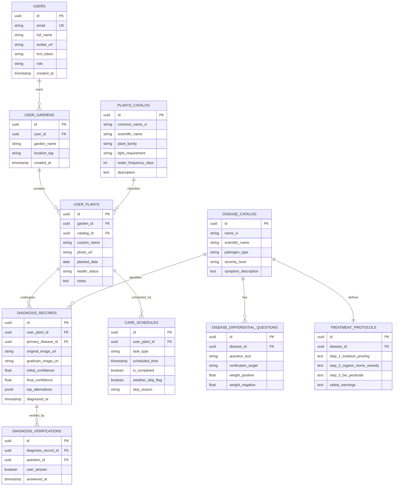

# TÀI LIỆU THIẾT KẾ KIẾN TRÚC HỆ THỐNG & CƠ SỞ DỮ LIỆU (US-004)

- **Mã User Story**: `US-004`
- **Tên tính năng**: Thiết kế kiến trúc hệ thống Client - Server và mô hình cơ sở dữ liệu
- **Người thực hiện**: `@architect`
- **Ngày hoàn thành**: 2026-10-18
- **Trạng thái**: HOÀN THÀNH (Bàn giao cho Senior Dev & ML Engineer)
- **Quy chuẩn tuân thủ**: [AGENT.md](../../AGENT.md), [urban-plant-trust-protocol.md](../../.agents/rules/urban-plant-trust-protocol.md), [ml-scientific-metrics.md](../../.agents/rules/ml-scientific-metrics.md)

---

## 1. Tổng quan Kiến trúc Hệ thống (System Architecture Overview)

Hệ thống **Urban Plants** được thiết kế theo mô hình **Hybrid Edge-Cloud Architecture** kết hợp phân tầng **Clean Architecture** nhằm giải quyết hai bài toán mấu chốt:
1. **Phản hồi tức thì & Hoạt động Offline**: Suy luận nhận diện bệnh trên thiết bị di động (On-device Inference với MobileNetV3-TFLite) cho trải nghiệm dưới 200ms không phụ thuộc đường truyền mạng.
2. **Minh bạch AI chuyên sâu (Explainable AI - XAI) & Quản lý Đám mây**: Tạo bản đồ nhiệt Grad-CAM, tái tính điểm số kiểm chứng chéo và lưu trữ hồ sơ bệnh án đồng bộ đa thiết bị qua Cloud Backend (FastAPI + PostgreSQL + Firebase).

---

## 2. Sơ đồ Kiến trúc Tổng thể (High-Level Architecture - C4 Container)

```mermaid
flowchart TB
    subgraph Client_Tier [Client Layer - Ứng dụng Di động]
        FlutterApp[Flutter Mobile App (iOS / Android)]
        TFLiteRuntime[TFLite Runtime (MobileNetV3 INT8 <15MB)]
        LocalCache[(SQLite / Hive Local Storage)]
        
        FlutterApp --> TFLiteRuntime
        FlutterApp --> LocalCache
    end

    subgraph External_Cloud [Dịch vụ Đám mây Ngoại vi]
        FirebaseAuth[Firebase Authentication (Google/OTP)]
        FCM[Firebase Cloud Messaging (Push Notifications)]
        CloudStorage[Firebase Storage / AWS S3 (Ảnh gốc & Heatmap)]
        WeatherAPI[OpenWeatherMap API (Thời tiết Đô thị)]
    end

    subgraph Backend_Tier [Backend Layer - FastAPI Microservices]
        APIGateway[FastAPI Gateway / REST API Engine]
        
        subgraph Internal_Modules [Phân tầng Clean Architecture]
            Controllers[Controller / Routing Layer]
            Services[Business Logic & Service Layer]
            AIService[AI Inference & Grad-CAM Service (PyTorch)]
            Repositories[Repository / Data Access Layer]
            
            Controllers --> Services
            Services --> AIService
            Services --> Repositories
        end
        
        APIGateway --> Controllers
    end

    subgraph Data_Tier [Persistence Layer - Dữ liệu & Cache]
        PostgresDB[(PostgreSQL 15 - Relational Database)]
        RedisCache[(Redis Cache - Session & Weather Data)]
        
        Repositories --> PostgresDB
        Services --> RedisCache
    end

    %% Tương tác hệ thống
    FlutterApp -->|HTTPS / REST API| APIGateway
    FlutterApp -->|Đăng nhập sinh trắc / OTP| FirebaseAuth
    FlutterApp -->|Nhận thông báo nhắc tưới| FCM
    APIGateway -->|Lưu/Tải ảnh lá bệnh| CloudStorage
    Services -->|Lấy dự báo mưa & sốc nhiệt| WeatherAPI
```

---

## 3. Chiến lược Suy luận AI Hybrid (Edge vs Cloud Inference)

| Tiêu chí so sánh | On-Device Inference (Edge) | Cloud Inference (FastAPI) |
| :--- | :--- | :--- |
| **Mô hình AI** | MobileNetV3 Quantized (INT8 / FP16) | MobileNetV3 / ResNet50 + Grad-CAM Engine |
| **Kích thước model** | `< 15 MB` (tích hợp trong app bundle) | `~80 - 150 MB` trên Cloud Server |
| **Thời gian phản hồi** | `< 180 ms` | `600 ms - 1200 ms` (bao gồm upload ảnh) |
| **Tính năng hỗ trợ** | Phân loại nhanh sơ bộ khi offline | Xuất ảnh nhiệt Grad-CAM, Top 3 bệnh, tính toán độ tương quan chéo |
| **Kịch bản kích hoạt** | Người dùng quét nhanh tại ban công; mạng yếu | Người dùng cần xem phân tích chi tiết, tạo phác đồ điều trị an toàn sinh học |

---

## 4. Thiết kế Phân tầng Phần mềm Backend (Clean Architecture Rules)

Tuân thủ nghiêm ngặt quy ước tại [AGENT.md](../../AGENT.md):
1. **API / Controller Layer (`api/v1/`)**:
   - Chỉ chịu trách nhiệm routing, parse request, xác thực token JWT và validate đầu vào bằng `Pydantic V2`.
   - Tuyệt đối không chứa logic tính toán nghiệp vụ hay truy vấn SQL trực tiếp.
2. **Service / Business Logic Layer (`services/`)**:
   - Xử lý nghiệp vụ lõi: Logic tái tính toán điểm số chẩn đoán (`DifferentialDiagnosisService`), sinh lịch tưới thích ứng thời tiết (`SmartScheduleService`), phác đồ Safe-First (`TreatmentProtocolService`).
   - Tích hợp bắt lỗi tường minh (Custom Exceptions) và ghi log theo chuẩn.
3. **Repository / Data Access Layer (`repositories/`)**:
   - Sử dụng `SQLAlchemy 2.0 (Async Engine)` để thao tác với cơ sở dữ liệu.
   - Trừu tượng hóa truy vấn, chống SQL Injection tuyệt đối qua ORM.

---

## 5. Mô hình Cơ sở Dữ liệu Chi tiết (Entity Relationship Diagram - ERD)



---

## 6. Từ điển Dữ liệu (Data Dictionary)

### 6.1. Bảng `DISEASE_CATALOG` (Danh mục Bệnh cây Đô thị)
- `id` (UUID, PK): Định danh duy nhất.
- `name_vi` (VARCHAR(150)): Tên bệnh tiếng Việt (vd: Bệnh Phấn Trắng, Đốm Đen Hoa Hồng, Nhện Đỏ).
- `scientific_name` (VARCHAR(150)): Tên khoa học của tác nhân nấm/khuẩn/côn trùng.
- `pathogen_type` (VARCHAR(50)): Phân loại tác nhân (`fungus`, `bacteria`, `pest`, `nutrient_deficiency`).
- `severity_level` (VARCHAR(20)): Mức độ nguy hại (`LOW`, `MEDIUM`, `CRITICAL`).

### 6.2. Bảng `TREATMENT_PROTOCOLS` (Phác đồ An toàn Sinh học 3 Tầng)
> Tuân thủ chuẩn [urban-plant-trust-protocol.md](../../.agents/rules/urban-plant-trust-protocol.md)
- `id` (UUID, PK): Định danh phác đồ.
- `disease_id` (UUID, FK): Khóa ngoại liên kết tới bảng `DISEASE_CATALOG`.
- `step_1_isolation_pruning` (TEXT): Hướng dẫn cách ly chậu cây, khoảng cách tối thiểu và khử trùng dụng cụ cắt tỉa.
- `step_2_organic_home_remedy` (TEXT): Công thức pha chế an toàn tại gia (Baking soda, nước rửa chén sinh học, dầu Neem, tỏi ớt gừng).
- `step_3_bio_pesticide` (TEXT): Danh mục hoạt chất sinh học được khuyến cáo (*Bacillus subtilis*, *Trichoderma*, *Copper Hydroxide*), cấm ghi nhãn thương mại độc hại.
- `safety_warnings` (TEXT): Cảnh báo an toàn cho vật nuôi (chó, mèo) và trẻ nhỏ xung quanh khu vực ban công.

### 6.3. Bảng `DISEASE_DIFFERENTIAL_QUESTIONS` (Bộ câu hỏi kiểm chứng chéo)
- `id` (UUID, PK): Định danh câu hỏi.
- `disease_id` (UUID, FK): Bệnh đang cần kiểm chứng.
- `question_text` (VARCHAR(255)): Nội dung câu hỏi kiểm chứng trực quan/xúc giác (Ví dụ: "Lớp phấn trắng có lau sạch được bằng tay không?").
- `weight_positive` (FLOAT): Trọng số cộng thêm nếu người dùng chọn "Có" (vd: +0.15).
- `weight_negative` (FLOAT): Trọng số phạt nếu người dùng chọn "Không" (vd: -0.25).

---

## 7. Đặc tả Giao diện Lập trình Ứng dụng (REST API Contracts)

### 7.1. Chẩn đoán AI & Grad-CAM Heatmap
- **Endpoint**: `POST /api/v1/diagnosis/predict`
- **Content-Type**: `multipart/form-data`
- **Request Body**:
  - `file`: Binary image (JPG/PNG, tối đa 10MB)
  - `plant_id`: UUID của cây trong vườn (optional)
- **Response** (`200 OK`):
```json
{
  "status": "success",
  "data": {
    "diagnosis_id": "7f8b3c21-9a1d-4d7e-9082-123456789abc",
    "primary_prediction": {
      "disease_id": "b1e9c4d2-3321-4f1a-8e2b-0987654321fe",
      "disease_name_vi": "Bệnh Phấn Trắng",
      "scientific_name": "Podosphaera pannosa",
      "pathogen_type": "fungus",
      "initial_confidence": 0.785,
      "severity": "MEDIUM"
    },
    "gradcam_result": {
      "heatmap_image_url": "https://storage.urbanplants.vn/gradcam/2026/10/7f8b3c21.jpg",
      "explanation_text": "Phát hiện vùng nhiệt tập trung ở mép và bề mặt lá non: Đốm bột trắng đặc trưng."
    },
    "differential_candidates": [
      {
        "disease_name_vi": "Bệnh Mốc Xám",
        "scientific_name": "Botrytis cinerea",
        "confidence": 0.142
      },
      {
        "disease_name_vi": "Dư lượng vôi đọng nước",
        "scientific_name": "Mineral Deposit",
        "confidence": 0.073
      }
    ],
    "verification_questions": [
      {
        "question_id": "q1-uuid",
        "question_text": "Lớp bụi trắng trên bề mặt có lau sạch được dễ dàng bằng tay không?"
      },
      {
        "question_id": "q2-uuid",
        "question_text": "Mặt dưới của lá có xuất hiện mạng nhện li ti hoặc đốm đen nhỏ li ti bò chậm không?"
      },
      {
        "question_id": "q3-uuid",
        "question_text": "Lá non mới nhú có hiện tượng bị xoăn gợn sóng và giòn vụn ở viền không?"
      }
    ]
  }
}
```

### 7.2. Tái tính toán Điểm số & Xuất Phác đồ Safe-First
- **Endpoint**: `POST /api/v1/diagnosis/verify`
- **Content-Type**: `application/json`
- **Request Body**:
```json
{
  "diagnosis_id": "7f8b3c21-9a1d-4d7e-9082-123456789abc",
  "answers": [
    {"question_id": "q1-uuid", "answer": true},
    {"question_id": "q2-uuid", "answer": false},
    {"question_id": "q3-uuid", "answer": true}
  ]
}
```
- **Response** (`200 OK`):
```json
{
  "status": "success",
  "data": {
    "diagnosis_id": "7f8b3c21-9a1d-4d7e-9082-123456789abc",
    "final_disease_name_vi": "Bệnh Phấn Trắng",
    "final_confidence": 0.942,
    "confidence_status": "HIGHLY_CONFIRMED",
    "treatment_protocol": {
      "step_1_isolation_pruning": "Tách chậu cây cách ly tối thiểu 1.5m. Cắt bỏ toàn bộ lá bệnh >50% bằng kéo đã tiệt trùng cồn 70°.",
      "step_2_organic_home_remedy": "Pha 5g Baking Soda + 5ml dầu ăn + 2ml nước rửa chén sinh học vào 1L nước ấm. Phun ướt đều vào sáng sớm.",
      "step_3_bio_pesticide": "Sử dụng chế phẩm sinh học Bacillus subtilis hoặc dung dịch Nano Bạc sinh học nếu tình trạng không thuyên giảm sau 5 ngày.",
      "safety_warnings": "An toàn tuyệt đối cho trẻ nhỏ và mèo nuôi trong nhà. Không hít trực tiếp sương phun."
    }
  }
}
```

---

## 8. Tiêu chí Đánh giá & Ranh giới Kỹ thuật (Technical Constraints)

1. **Hiệu năng & Độ trễ**:
   - On-device TFLite inference: `< 200ms` trên chip Snapdragon 680 / Apple A12 trở lên.
   - Cloud Inference + Grad-CAM generation: `< 1.2s` trên GPU T4 / CPU 4 cores.
2. **Bảo mật & Tính vẹn toàn dữ liệu**:
   - Tất cả kết nối qua HTTPS/TLS 1.3.
   - Ảnh người dùng upload được lưu trữ với UUID ngẫu nhiên, không để lộ thông tin đường dẫn cá nhân.
   - Các API nhạy cảm yêu cầu JWT Bearer Token trong Header.
